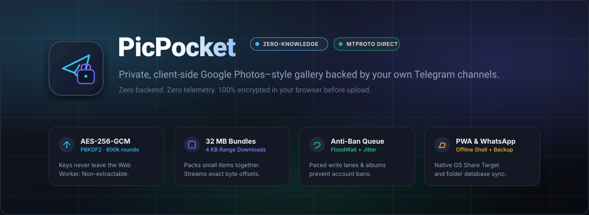
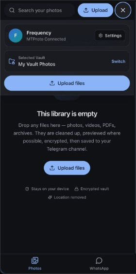
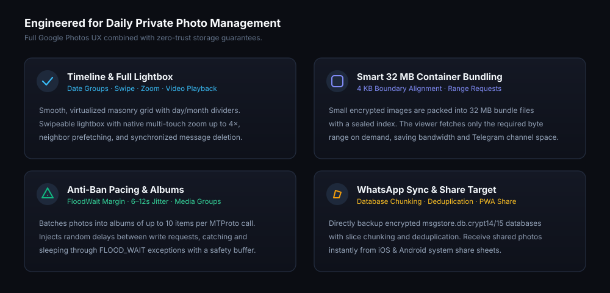
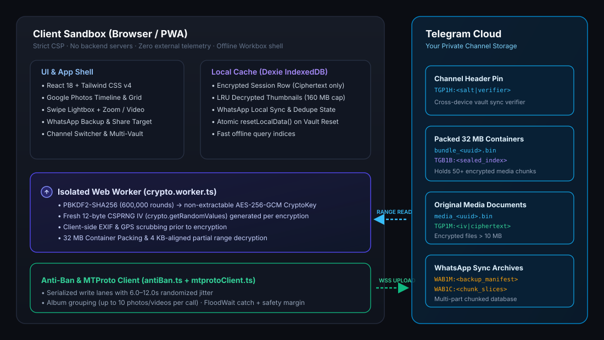
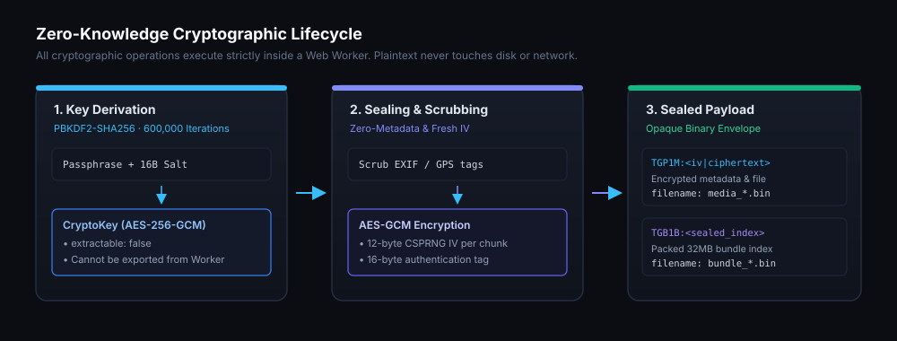

# PicPocket

<p align="center">
  
</p>

<p align="center">
  <a href="LICENSE"></a>
  
  
  
  
</p>

---

PicPocket is a private, client-side photo gallery that turns your own Telegram channels into an encrypted cloud vault. It gives you the clean interface of Google Photos—timeline view, zoom, video streaming, search, and album management—without storage subscription fees or privacy compromises.

Everything runs directly in your browser. Media is encrypted locally on your device with AES-256-GCM before upload, so neither Telegram nor any third party can ever see your photos.

---

## The Core Idea

Most cloud photo services give you 15 GB for free, then lock you into recurring monthly subscriptions. Meanwhile, Telegram provides unlimited file storage in private channels, but uploading personal pictures manually has big drawbacks:
- Your raw, unencrypted photos sit on Telegram's servers.
- Hidden GPS coordinates and camera serial numbers stay attached.
- Uploading hundreds of pictures one by one clutters your chats and risks triggering Telegram's automated spam filters.

**PicPocket solves this cleanly:**
It sits entirely in your browser as a Progressive Web App (PWA). You pick photos, PicPocket strips location tags, encrypts the files with a passphrase only you know, and packs them into neat binary bundles inside your private Telegram channel. When you open the app, it pulls and decrypts only the thumbnails and photos you're actually looking at.

---

<p align="center">
  
  <br />
  <em>PicPocket running as an installed PWA on mobile with full-width search and bottom navigation.</em>
</p>

---

## Why PicPocket?

- **Unlimited private storage:** Backed by your private Telegram channel. No tiers, no storage caps, no monthly charges.
- **End-to-end encrypted:** Every photo, video, and thumbnail is encrypted with AES-256-GCM before it leaves your machine. Telegram only stores opaque `.bin` files.
- **Fast and data-efficient:** Opening your gallery doesn't download gigabytes of data. PicPocket requests only the exact byte ranges (down to 4 KB) needed for visible previews.
- **Works like a native app:** Install it to your phone or desktop home screen with one tap. It even shows up in your phone's native **"Share"** menu.
- **Keeps your Telegram account safe:** Unlike naive upload scripts that trigger account bans, PicPocket batches files into media albums and enforces human-like delays between uploads.
- **Includes WhatsApp backups:** Easily archive raw WhatsApp database backups (`msgstore.db.crypt14/15`) and chat media with deduplication.

---

## Why You Can Trust It

When a tool claims to be "private", you shouldn't have to take the developer's word for it. Here is how PicPocket guarantees security by design:

1. **Zero backend servers:** There is no middleman server, no proxy, and no database running behind PicPocket. The entire app is a static client. If you open your browser's Network Inspector (F12), you will see that connections go strictly to your own host for static assets and to official Telegram servers (`*.telegram.org`) for data.
2. **Keys stay in memory:** Your passphrase derives an encryption key inside an isolated Web Worker using PBKDF2-SHA256 (600,000 iterations). The resulting key is explicitly marked `extractable: false`, meaning even malicious scripts or browser extensions cannot dump the key from memory.
3. **Automatic EXIF and GPS stripping:** Modern smartphones embed exact GPS coordinates, timestamps, and device identifiers into photo metadata. PicPocket scrubs this metadata on your device before encryption.
4. **No telemetry or tracking:** No Google Analytics, no tracking pixels, no advertising SDKs, and no cookies.
5. **Completely open source:** Every line of cryptographic and networking code is here in this repository for you to audit, fork, or self-host.

---

## PicPocket vs. Typical Telegram Storage Projects

Many open-source projects attempt to use Telegram as free cloud storage. Most of them rely on command-line bots or simple scripts. Here is how PicPocket is different:

| Feature | Standard Telegram Bots & Scripts | PicPocket |
| :--- | :--- | :--- |
| **Interface** | Text chats, command-line scripts, or basic tables | **Familiar photo gallery:** Timeline, pinch-to-zoom, video streaming |
| **Data Privacy** | Plaintext uploads (Telegram and bot hosts can view every photo) | **Encrypted locally with AES-256-GCM** before sending |
| **Hosting Requirements** | Requires hosting a Python/Node server or Docker container 24/7 | **Zero backend.** Pure static web app running in your browser |
| **File Limit & Type** | Bot API limits files to 20–50 MB | **Direct MTProto client** supporting files up to Telegram's 2 GB limit |
| **Account Ban Safety** | High ban risk (tight loops quickly trigger `FloodWaitError`) | **Built-in pacing engine:** 6–12s random delays + album batching |
| **Bandwidth Use** | Re-downloads the full file just to render a thumbnail | **4 KB Range Requests:** streams only the bytes needed for on-screen tiles |
| **Location Scrubbing** | Leaves GPS coordinates and camera metadata attached | **Automatic client-side EXIF/GPS scrubbing** before encryption |
| **Mobile Integration** | None (desktop terminal or chat commands only) | **Installable PWA with native OS Share Target support** |
| **Chat Tidiness** | Spams hundreds of single messages in your chat | **Packs files into 32 MB bundles** with encrypted indexes |

---

<p align="center">
  
</p>

---

## How It Works Under the Hood

<p align="center">
  
</p>

1. **Direct Connection:** When you sign in, the app connects directly to Telegram's MTProto servers via WebSocket.
2. **Key Derivation:** You choose a master passphrase. The app runs 600,000 rounds of PBKDF2-SHA256 in a Web Worker to derive a 256-bit AES-GCM key.
3. **Bundling & Encryption:**
   - Files larger than 10 MB are encrypted individually with a fresh 12-byte random IV.
   - Smaller files are packed together into 32 MB containers (`bundle_<uuid>.bin`) with an encrypted index (`TGB1B:`). This keeps your Telegram channel organized instead of cluttering it with thousands of tiny files.
4. **On-Demand Streaming:** When you scroll through your timeline, the app reads the encrypted bundle index and fetches only the required byte ranges from Telegram using 4 KB-aligned MTProto requests.
5. **Session Protection:** Your active Telegram session is sealed using your vault key before being stored in browser IndexedDB (Dexie). If someone gets physical access to your device, they cannot resume your Telegram session without your passphrase.

---

## Cryptographic Details

<p align="center">
  
</p>

- **Key Stretcher:** PBKDF2 with SHA-256, 600,000 iterations, and a 16-byte cryptographically secure random salt.
- **Encryption:** AES-256-GCM with 128-bit authentication tags to verify file integrity.
- **Nonce / IV:** A fresh 12-byte IV generated via `crypto.getRandomValues()` for every single chunk, thumbnail, and envelope. Zero IV reuse.
- **Key Isolation:** The derived `CryptoKey` is set to `extractable: false` and kept inside the Web Worker context.
- **Channel Header (`TGP1H:`):** A public salt and encrypted verifier pinned in the channel allows you to unlock the same vault on multiple devices without your password ever leaving your head.

---

## Anti-Ban & Telegram Rate Limits

Telegram actively flags and bans accounts that automate spammy upload loops. PicPocket is designed from the ground up to operate safely within Telegram's fair-use limits:

- **Album Batching:** Automatically groups up to 10 photos or videos per request using native MTProto media albums instead of hammering the API with separate calls.
- **Randomized Jitter:** Uploads are spaced with randomized delays (6 to 12 seconds) to simulate natural human activity.
- **FloodWait Protection:** If Telegram issues a rate-limit warning (`FLOOD_WAIT_X`), PicPocket pauses automatically for the required duration plus an extra 4-second safety buffer.
- **Cached Entity Hashes:** Channels and access hashes are cached locally to avoid repetitive entity resolution lookups.

---

## Getting Started

### Prerequisites
- Node.js 20 or newer
- A Telegram account and an API App ID (create one in seconds at [my.telegram.org/apps](https://my.telegram.org/apps))

### Running Locally

```bash
# 1. Clone the repository
git clone https://github.com/frequency/PicPocket.git
cd PicPocket

# 2. Install dependencies
npm install

# 3. Configure Telegram API credentials
cp .env.example .env
# Open .env and set your VITE_TELEGRAM_API_ID and VITE_TELEGRAM_API_HASH

# 4. Start the dev server
npm run dev
```

Open `http://localhost:5173` in your browser.

> **Tip:** Supplying `VITE_TELEGRAM_API_*` in `.env` is optional. If left blank, PicPocket simply asks for your API ID on the login screen and keeps it safely in your local browser storage.

### Useful Commands

| Command | What it does |
| :--- | :--- |
| `npm run dev` | Starts Vite local development server |
| `npm run build` | Compiles production assets and generates PWA files in `dist/` |
| `npm run preview` | Serves the production build locally |
| `npm run typecheck` | Runs `tsc --noEmit` to verify TypeScript types |
| `npm run icons` | Re-generates PWA app icons |

---

## Deploying Your Own Copy

Because PicPocket has no backend, you can deploy it to any free static host in minutes.

### Cloudflare Pages

1. Link your GitHub repository to Cloudflare Pages.
2. Build configuration:
   - **Framework:** Vite
   - **Build command:** `npm run build`
   - **Output directory:** `dist`
3. Under **Settings → Environment Variables**, add your `VITE_TELEGRAM_API_ID` and `VITE_TELEGRAM_API_HASH`.
4. Deploy. The included `public/_headers` file automatically applies strict security policies (CSP, X-Frame-Options, and Permissions-Policy).

### Vercel

Import the repository in Vercel with standard Vite settings. The provided `vercel.json` configures single-page application routing and security headers automatically.

---

## Project Structure

```text
PicPocket/
├── docs/
│   └── images/              # Architecture diagrams, flowcharts, and screenshots
├── public/
│   ├── _headers             # Security headers and CSP rules
│   ├── manifest.json        # PWA manifest & Web Share Target setup
│   └── theme-init.js        # Script to prevent dark/light theme flashing
├── src/
│   ├── components/          # Gallery grid, lightbox, upload modals, WhatsApp view
│   ├── hooks/               # State hooks for auth, timeline, media loading
│   ├── lib/                 # Formatting, timeline grouping, config
│   ├── services/
│   │   ├── cache/           # Dexie IndexedDB caching for thumbnails & sessions
│   │   ├── crypto/          # Web Worker crypto client and encoding helpers
│   │   ├── media/           # Bundle packing, range streaming, EXIF stripping
│   │   ├── telegram/        # MTProto connection, anti-ban pacing, caption parser
│   │   └── whatsapp/        # WhatsApp backup parser and deduplication
│   ├── workers/             # Isolated AES-256-GCM / PBKDF2 Web Worker
│   ├── App.tsx              # Main UI routing and state management
│   ├── main.tsx             # Application entrypoint
│   └── sw.ts                # Service worker for offline shell & Share Target
├── SECURITY.md              # Detailed security audit notes and threat model
└── vite.config.ts           # Bundler and PWA build configuration
```

---

## License

PicPocket is open-source software licensed under the [MIT License](LICENSE).
